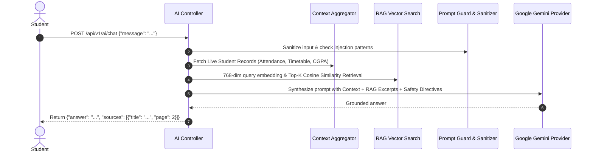

# CampusIQ AI & RAG Architecture

## Core Principle

CampusIQ AI is **NOT a generic chatbot**. It is an intelligent academic reasoning agent deeply grounded in the authenticated student's real-time university database records and verified institutional documents.

---

## 1. Multi-Stage Pipeline

---

## 2. Context Isolation & Security

- **Student Data Isolation**: The system queries records using `req.user.id` extracted strictly from the verified JWT.
- **Prompt Injection Defense**: Guard checks for jailbreak markers, prompt revelation queries, and system overrides.
- **Factual Grounding**: If information is absent from university records or documents, the AI issues a grounded uncertainty refusal rather than hallucinating answers.
