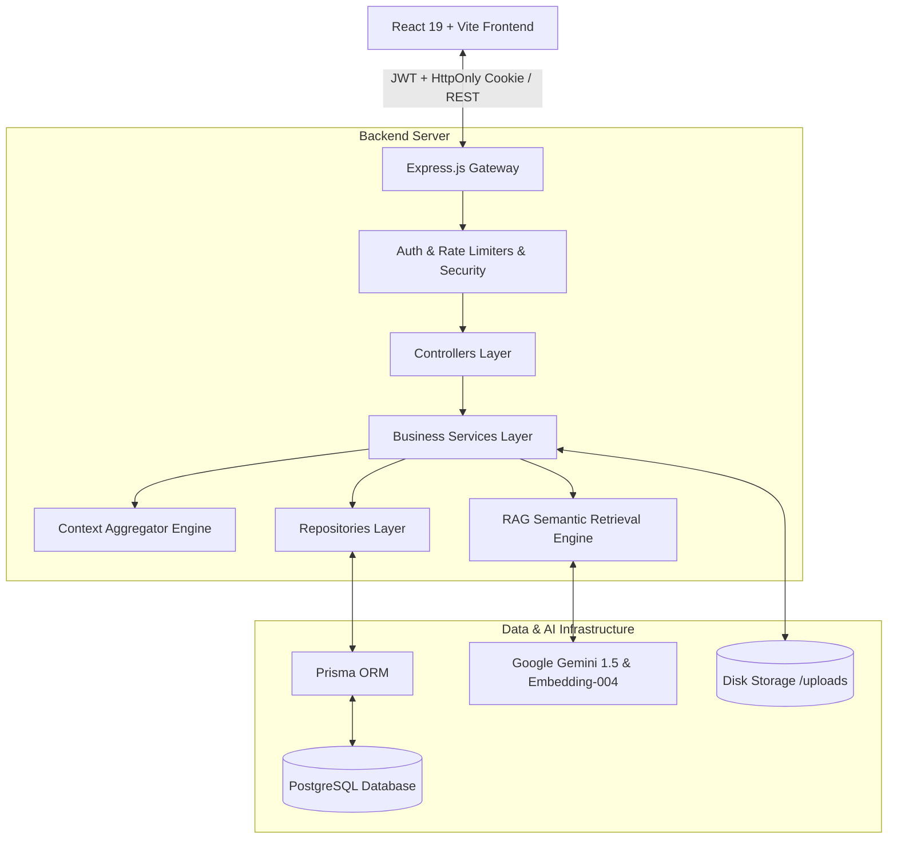

# CampusIQ System Architecture

## Overview

**CampusIQ** is an AI-powered Smart Campus Operating System built with a decoupled client-server architecture designed for high scalability, real-time contextual intelligence, and robust security.

---

## 1. Architectural Layers

### Frontend Architecture

- **Framework**: React 19 + TypeScript + Vite.
- **Routing & State**: React Router with Role-Based Route Guards and `@tanstack/react-query` for asynchronous server-state management.
- **Styling & UI**: Vanilla Tailwind CSS + Glassmorphism tokens + Framer Motion animations + Recharts academic analytics.
- **API Communication**: Centralized Axios client with automatic 401 interceptors and transparent refresh-token rotation queues.

### Backend Architecture

- **Runtime**: Node.js + Express.js in TypeScript Strict Mode.
- **Layered Pattern**: `Controllers` (Request/Response mapping) $\rightarrow$ `Services` (Business logic) $\rightarrow$ `Repositories` (Database queries via Prisma).
- **Security**: Helmet security headers, CORS origin isolation, Zod payload validation, Bcrypt password hashing (Cost 12), and JWT access tokens (15m expiry) with persistent refresh tokens (7d expiry).

### AI & Context-Aware RAG Architecture

- **Embedding Generation**: 768-dimensional vector representations using `text-embedding-004`.
- **Context Injection**: The AI assistant combines live authenticated student records (attendance rates, timetable slots, CGPA) with top-$K$ semantic search results from indexed university documents.
- **Prompt Guard**: Multi-stage prompt injection detection and strict system instructions to guarantee factual grounding and prevent hallucinations.
