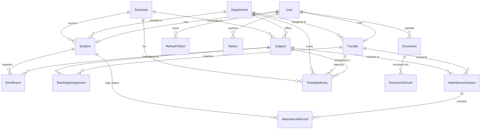

# CampusIQ Database Architecture

## Overview

CampusIQ uses **PostgreSQL** paired with **Prisma ORM** for enterprise-grade relational integrity, foreign key cascading, unique constraints, and high-performance indexed queries.

---

## Entity Relationship Summary

---

## Core Models

1. **User**: UUID primary key, unique email, role (`STUDENT`, `FACULTY`, `ADMIN`), hashed password, audit timestamps, soft delete flag.
2. **Student**: Linked 1:1 with User, roll number unique constraint, department/semester relations, current CGPA.
3. **Faculty**: Linked 1:1 with User, employeeId unique constraint, designation, department relation.
4. **AttendanceSession & AttendanceRecord**: Unique compound constraint `[sessionId, studentId]` preventing double-marking of attendance.
5. **TimetableEntry**: Indexed by day of week and timeslots, validated against room, faculty, and semester conflicts.
6. **Document & DocumentChunk**: Supports chunk storage, page numbers, and 768-dimensional embeddings for RAG vector search.
